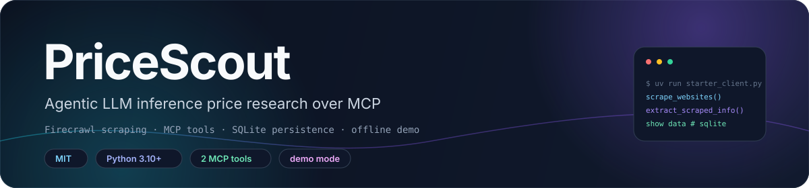
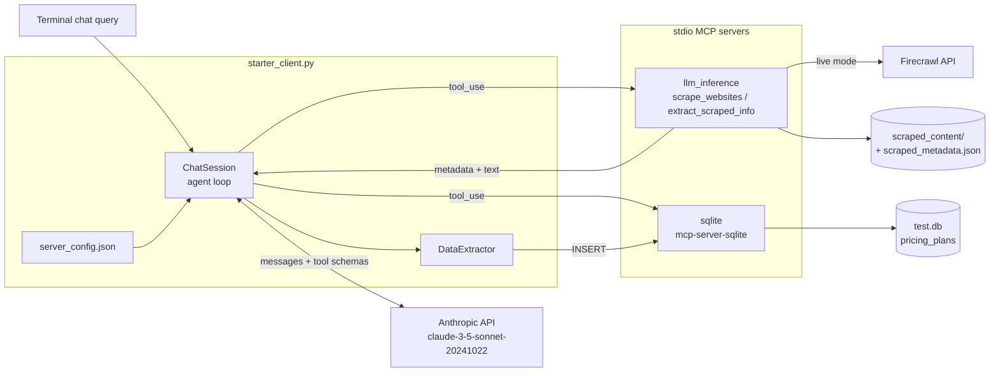

<div align="center">



# PriceScout

**An MCP research assistant that scrapes and compares LLM inference pricing across providers.**

Firecrawl scraping · stdio MCP tools · SQLite persistence · Anthropic tool use · offline demo mode

[**简体中文**](README.zh-CN.md) · **English**

<a href="LICENSE"></a>
<a href="pyproject.toml"></a>
<a href="docs/reference.md"></a>
<a href="docs/reference.md"></a>
<a href=".env.example"></a>

</div>

> [!NOTE]
> **Current state.** The repository holds a working MCP server (`starter_server.py`), an MCP client
> with an Anthropic tool-use loop (`starter_client.py`), two `unittest` tests, and demo transcripts.
> There is no CI workflow or published package; local run artifacts are excluded via `.gitignore`.

## ✨ Features

- **Two scraping tools.** `scrape_websites` collects provider pricing pages; `extract_scraped_info`
  returns the stored text for a provider name, URL, or domain.
- **Files on disk.** Every scrape writes `scraped_content/<provider>_<format>.txt` and rewrites
  `scraped_content/scraped_metadata.json` with URL, domain, timestamp, formats, and a success flag.
- **Failures are recorded, not thrown.** A provider that cannot be scraped is stored with
  `success: "false"` and the error string; the remaining providers in the batch are still processed.
- **Two MCP servers at once.** `llm_inference` runs from this repo; `sqlite` runs
  `mcp-server-sqlite` through `uvx`. The client discovers and merges the tool lists of both.
- **Agent loop over stdio.** Each Anthropic `tool_use` block is routed to the server that owns the
  tool, and the text result is sent back until the model stops calling tools.
- **Structured persistence.** Extracted plans go into a `pricing_plans` table: company, plan,
  input/output token price, currency, billing period, features, limitations, and the source question.
- **Deterministic demo mode.** `PRICESCOUT_DEMO_MODE=1` swaps Firecrawl and Anthropic for built-in
  provider text and a fixed answer, so the wiring can be shown without keys.
- **Two unit tests.** `tests/test_server_tools.py` covers demo scrape persistence and lookup by domain.

## 🧠 Architecture



The client is one file: `Configuration` reads `.env` and `server_config.json`, `Server` wraps a
stdio session with retries, `ChatSession` runs the tool-use loop and the `show data` command, and
`DataExtractor` creates the table and writes rows. The server is a single `FastMCP("llm_inference")`
instance with two tools and a `DEMO_PRICING` table. Full tool, schema, and runtime reference:
[`docs/reference.md`](docs/reference.md).

## 🚀 Quick start

**Requirements:** Python 3.10+, [`uv`](https://docs.astral.sh/uv/), and network access. Live runs
also need an Anthropic API key and a Firecrawl API key; demo mode needs neither.

```sh
git clone https://github.com/LeoLin990405/pricescout-agentic-analyst.git
cd pricescout-agentic-analyst
uv sync
cp .env.example .env
```

Demo mode is the fastest way to see the full path — scraping, extraction, SQLite insert, comparison:

```sh
PRICESCOUT_DEMO_MODE=1 uv run python starter_client.py
```

For live scraping and live answers, put both keys in `.env` **and** turn the demo switch off —
`.env.example` ships with `PRICESCOUT_DEMO_MODE=1`, and `load_dotenv()` keeps that value:

```dotenv
ANTHROPIC_API_KEY=your_anthropic_key
FIRECRAWL_API_KEY=your_firecrawl_key
PRICESCOUT_DEMO_MODE=0
```

```sh
uv run python starter_client.py
```

At the `Query:` prompt enter a question, `show data` to print the last five stored rows, or `quit`.
Prompts that match the default provider list:

```text
How much does CloudRift charge for deepseek v3?
How much does DeepInfra charge for deepseek v3?
Compare CloudRift and DeepInfra costs for deepseek v3
```

> [!TIP]
> `PRICESCOUT_DEMO_MODE=1` also satisfies the key checks: the client substitutes
> `demo-mode-no-key` for the Anthropic key and the server never constructs a Firecrawl client.

## 🤖 MCP surface

| Server | Tool | Arguments | Result |
|---|---|---|---|
| `llm_inference` | `scrape_websites` | `websites` map, `formats`, optional `api_key` | list of provider keys that succeeded |
| `llm_inference` | `extract_scraped_info` | `identifier` | indented JSON: metadata plus `content` per format |
| `sqlite` | `write_query`, `read_query` | SQL string | created tables / inserted rows / query rows |
| `sqlite` | `create_table`, `list_tables`, `describe_table`, `append_insight` | tool-specific | schema inspection helpers, unused by this project |

`server_config.json` is the launch table the client reads:

| Entry | Command | Args |
|---|---|---|
| `llm_inference` | `python` | `starter_server.py` |
| `sqlite` | `uvx` | `mcp-server-sqlite --db-path ./test.db` |

The client validates that `mcpServers` exists and that each entry has a `command` and a list-valued
`args`. Any MCP client that can launch a stdio server can reuse `starter_server.py` directly:
`python starter_server.py` starts the server on stdio.

## 🗄️ Persistence

| Artifact | Written by | Contents |
|---|---|---|
| `scraped_content/<provider>_<format>.txt` | `scrape_websites` | page content per requested format |
| `scraped_content/scraped_metadata.json` | `scrape_websites` | all providers seen so far, keyed by normalised name |
| `test.db` → `pricing_plans` | `DataExtractor` via the SQLite MCP server | one row per extracted plan |

`pricing_plans` has 11 columns, including `company_name`, `plan_name`, `input_tokens`,
`output_tokens`, `currency`, `billing_period`, `features`, `limitations`, `source_query`, and
`created_at`. The full DDL, the metadata field table, and the lookup order are in
[`docs/reference.md`](docs/reference.md#pricing_plans-schema).

Both `scraped_content/` and `test.db` are listed in `.gitignore`, so a fresh clone starts empty and
nothing is shared between machines.

## 📊 Evidence & demo mode

| Signal | Recorded result | Source |
|---|---|---|
| Providers scraped | 4/4 in demo mode | [`evidence_terminal_output.txt`](evidence_terminal_output.txt) |
| Plans stored | 2 (CloudRift, DeepInfra) | [`evidence_terminal_output.txt`](evidence_terminal_output.txt) |
| Demo comparison | CloudRift $0.27 input / $1.10 output vs. DeepInfra $0.27 input / $1.00 output per 1M tokens | [`evidence_terminal_output.txt`](evidence_terminal_output.txt) |
| Unit tests | 2 tests, `OK` | [`test_output.txt`](test_output.txt) |
| Walkthrough | 3 pages: scraping, extraction, final comparison | [`evidence.pdf`](evidence.pdf) |

> [!WARNING]
> The four demo pages are hard-coded sample text in `starter_server.py`, not prices read from the
> providers at run time. Check the provider pages before quoting any number; live mode exists
> precisely because these values are not maintained.

The recorded run is a demo-mode transcript, so it shows the MCP calls, the persistence path, and the
`show data` output rather than a live market comparison. The two tests in
[`tests/test_server_tools.py`](tests/test_server_tools.py) also run against demo text and need no keys.

## 📁 Repository layout

| Path | Contents |
|---|---|
| `starter_server.py` | `llm_inference` FastMCP server: scraping tools, metadata handling, demo pricing text |
| `starter_client.py` | stdio MCP client, Anthropic tool-use loop, SQLite extraction, chat commands |
| `server_config.json` | MCP server launch entries for the client |
| `.env.example` | key placeholders and the demo-mode switch |
| `requirements.txt` | four direct runtime dependencies |
| `pyproject.toml`, `uv.lock` | starter-template project metadata and the resolved lockfile |
| `tests/test_server_tools.py` | two `unittest` cases for scraping and lookup |
| `docs/reference.md` | tool contracts, schema, runtime settings, troubleshooting |
| `docs/assets/banner.svg` | banner used by both READMEs |
| `evidence.pdf` | 3-page visual evidence of the workflow |
| `evidence_terminal_output.txt` | demo-mode terminal transcript (71 lines) |
| `test_output.txt` | recorded test run |
| `LICENSE` | MIT license text |
| `.gitignore` | excludes `.env`, `test.db`, `scraped_content/`, `.venv/`, caches |

## 🛠️ Development

```sh
uv sync
python -m unittest discover -s tests -t .
```

The tests patch `SCRAPE_DIR` into a temporary directory and set `PRICESCOUT_DEMO_MODE`, so they do
not touch `scraped_content/` or the network. The last recorded run in
[`test_output.txt`](test_output.txt) reports `Ran 2 tests ... OK`; this repository has no CI, so no
badge claims a pipeline status.

`pyproject.toml` is still the starter template: project name `mcp-project`, version `0.1.0`, and no
build system or console scripts. It also lists packages the two scripts do not import (`aiohttp`,
`bs4`, `gradio[mcp]`, `ipykernel`, `textblob`), while `requirements.txt` carries the actual runtime
set: `anthropic`, `firecrawl-py`, `mcp`, `python-dotenv`.

## 🧭 Scope, limits & roadmap

The project demonstrates an MCP scraping-plus-persistence workflow. It is not a price index and
does not keep prices current. Known boundaries:

- **Demo text is static.** `DEMO_PRICING` covers CloudRift, DeepInfra, Fireworks, and Groq; any other
  provider gets a placeholder page with no numbers.
- **Demo extraction is regex-only.** `_demo_structured_extraction` recognises CloudRift and DeepInfra
  price sentences and ignores the rest.
- **Live extraction is unvalidated model output.** The client strips code fences and calls
  `json.loads`; failures are logged and swallowed, leaving the table unchanged.
- **No history or de-duplication.** Each run appends rows to `pricing_plans`; there is no unique key,
  no update path, and no currency conversion.
- **Interactive only.** The entry point is a stdin chat loop; there is no non-interactive batch mode.
- **Pinned model.** Both the chat loop and the extractor call `claude-3-5-sonnet-20241022`.
- **No CI, packaging, or lint configuration.** No workflow files, no formatter or type-checker setup.

Roadmap:

- [ ] Add a provider registry so live URLs and demo pages stay in sync
- [ ] Snapshot prices with a run id and date instead of appending anonymous rows
- [ ] Add a unique key and an update path for repeated runs
- [ ] Validate extracted JSON against a schema before inserting
- [ ] Add a non-interactive entry point and a CI workflow for the two tests
- [ ] Trim the starter-template dependencies from `pyproject.toml`

## 🤝 Contributing

1. Run `python -m unittest discover -s tests -t .` before opening a PR.
2. Keep the demo path working without keys — it is the only reproducible path in this repo.
3. Never commit `.env`, `test.db`, or `scraped_content/`; they are ignored for that reason.
4. Do not present demo prices as observed market data in docs or issues.

If PriceScout is useful to you, consider leaving a ⭐ — it helps others find the project.

## 📄 License & attribution

PriceScout is licensed under the [MIT License](LICENSE), © 2026 Leo Lin. There is no `NOTICE` file in
this repository. Third-party components keep their own licenses: [Firecrawl](https://www.firecrawl.dev/)
for scraping, the [Anthropic Python SDK](https://github.com/anthropics/anthropic-sdk-python) for model
calls, the [MCP Python SDK](https://github.com/modelcontextprotocol/python-sdk) for the server and
client, `mcp-server-sqlite` for the SQL tools, and [`uv`](https://docs.astral.sh/uv/) for the
environment. Provider names and pricing pages linked below belong to their respective owners.

Default provider pages: [CloudRift](https://www.cloudrift.ai/inference) ·
[DeepInfra](https://deepinfra.com/pricing) ·
[Fireworks](https://fireworks.ai/pricing#serverless-pricing) · [Groq](https://groq.com/pricing).

## ⭐ Star history

<div align="center">

<a href="https://star-history.com/#LeoLin990405/pricescout-agentic-analyst&Date">
  
</a>

</div>
