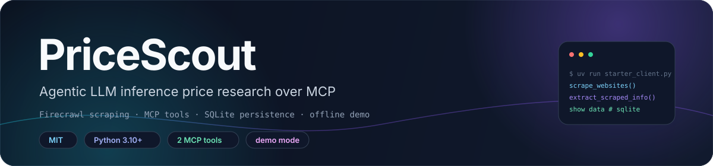
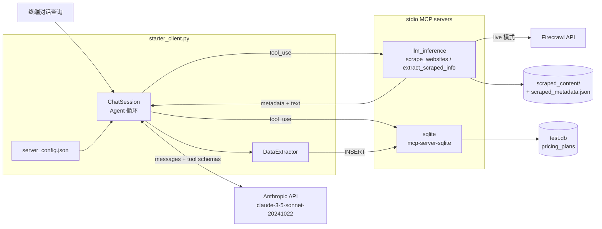

<div align="center">



# PriceScout

**一个抓取并对比各家 LLM 推理定价的 MCP 研究助手。**

Firecrawl 抓取 · stdio MCP 工具 · SQLite 落库 · Anthropic 工具调用 · 离线 demo 模式

**简体中文** · [**English**](README.md)

<a href="LICENSE"></a>
<a href="pyproject.toml"></a>
<a href="docs/reference.md"></a>
<a href="docs/reference.md"></a>
<a href=".env.example"></a>

</div>

> [!NOTE]
> **当前状态。** 仓库里有一个可运行的 MCP server（`starter_server.py`）、一个带 Anthropic 工具调用
> 循环的 MCP client（`starter_client.py`）、两个 `unittest` 用例和 demo 运行记录。没有 CI 工作流，
> 也没有发布任何包；本地运行产物通过 `.gitignore` 排除。

## ✨ 特性

- **两个抓取工具。** `scrape_websites` 抓取 provider 定价页；`extract_scraped_info` 按 provider
  名称、URL 或域名取回已存文本。
- **内容落盘。** 每次抓取写 `scraped_content/<provider>_<format>.txt`，并重写
  `scraped_content/scraped_metadata.json`，记录 URL、域名、时间戳、格式与成功标记。
- **失败只记录，不抛出。** 抓取失败的 provider 会以 `success: "false"` 和错误字符串写入，
  同一批次的其他 provider 仍继续处理。
- **同时连两个 MCP server。** `llm_inference` 来自本仓库；`sqlite` 通过 `uvx` 启动
  `mcp-server-sqlite`。client 会合并两边暴露的工具列表。
- **基于 stdio 的 Agent 循环。** 每个 Anthropic `tool_use` 块被路由到拥有该工具的 server，
  文本结果回传给模型，直到模型不再调用工具。
- **结构化落库。** 提取出的方案写入 `pricing_plans` 表：公司、方案、输入/输出 token 价格、
  币种、计费周期、特性、限制，以及产生该行的原始问题。
- **确定性的 demo 模式。** `PRICESCOUT_DEMO_MODE=1` 用内置 provider 文本和固定答案替换
  Firecrawl 与 Anthropic，没有 key 也能演示整条链路。
- **两个单元测试。** `tests/test_server_tools.py` 覆盖 demo 抓取落盘与按域名查询。

## 🧠 架构



client 只有一个文件：`Configuration` 读取 `.env` 与 `server_config.json`，`Server` 封装带重试的
stdio 会话，`ChatSession` 跑工具调用循环和 `show data` 命令，`DataExtractor` 建表并写行。server 是
一个 `FastMCP("llm_inference")` 实例，挂两个工具和一张 `DEMO_PRICING` 表。完整的工具契约、表结构和
运行时参数见 [`docs/reference.md`](docs/reference.md)。

## 🚀 快速开始

**要求：** Python 3.10+、[`uv`](https://docs.astral.sh/uv/)，以及可用的网络。live 运行还需要
Anthropic API key 与 Firecrawl API key；demo 模式两者都不需要。

```sh
git clone https://github.com/LeoLin990405/pricescout-agentic-analyst.git
cd pricescout-agentic-analyst
uv sync
cp .env.example .env
```

想最快看到完整链路（抓取、提取、写入 SQLite、给出对比），直接跑 demo：

```sh
PRICESCOUT_DEMO_MODE=1 uv run python starter_client.py
```

要走真实抓取与真实回答，把两个 key 填进 `.env`，**同时把 demo 开关关掉**——
`.env.example` 里默认就是 `PRICESCOUT_DEMO_MODE=1`，`load_dotenv()` 会把这个值带进来：

```dotenv
ANTHROPIC_API_KEY=your_anthropic_key
FIRECRAWL_API_KEY=your_firecrawl_key
PRICESCOUT_DEMO_MODE=0
```

```sh
uv run python starter_client.py
```

在 `Query:` 提示符下输入问题，`show data` 打印最近 5 条记录，`quit` 退出。与默认 provider 列表对应的
提问示例：

```text
How much does CloudRift charge for deepseek v3?
How much does DeepInfra charge for deepseek v3?
Compare CloudRift and DeepInfra costs for deepseek v3
```

> [!TIP]
> `PRICESCOUT_DEMO_MODE=1` 也会满足 key 检查：client 用 `demo-mode-no-key` 顶替 Anthropic key，
> server 则完全不会构造 Firecrawl client。

## 🤖 MCP 接口

| Server | 工具 | 参数 | 返回 |
|---|---|---|---|
| `llm_inference` | `scrape_websites` | `websites` 映射、`formats`、可选 `api_key` | 抓取成功的 provider key 列表 |
| `llm_inference` | `extract_scraped_info` | `identifier` | 带缩进的 JSON：元数据加按格式的 `content` |
| `sqlite` | `write_query`、`read_query` | SQL 字符串 | 建表 / 插入行 / 查询结果 |
| `sqlite` | `create_table`、`list_tables`、`describe_table`、`append_insight` | 各工具自有参数 | schema 检查辅助工具，本项目未使用 |

client 读取的启动表是 `server_config.json`：

| 条目 | 命令 | 参数 |
|---|---|---|
| `llm_inference` | `python` | `starter_server.py` |
| `sqlite` | `uvx` | `mcp-server-sqlite --db-path ./test.db` |

client 会校验 `mcpServers` 存在，且每个条目都有 `command` 和列表类型的 `args`。任何能拉起 stdio
server 的 MCP client 都可以直接复用 `starter_server.py`：`python starter_server.py` 即在 stdio 上
启动该 server。

## 🗄️ 数据落库

| 产物 | 写入方 | 内容 |
|---|---|---|
| `scraped_content/<provider>_<format>.txt` | `scrape_websites` | 每种请求格式的页面内容 |
| `scraped_content/scraped_metadata.json` | `scrape_websites` | 迄今见过的全部 provider，按规范化名称索引 |
| `test.db` → `pricing_plans` | `DataExtractor`，经 SQLite MCP server 写入 | 每个提取出的方案一行 |

`pricing_plans` 共 11 列，包括 `company_name`、`plan_name`、`input_tokens`、`output_tokens`、
`currency`、`billing_period`、`features`、`limitations`、`source_query` 与 `created_at`。完整 DDL、
元数据字段表和匹配顺序见 [`docs/reference.md`](docs/reference.md#pricing_plans-schema)。

`scraped_content/` 与 `test.db` 都列在 `.gitignore` 中，所以新克隆的仓库是空的，也不存在跨机器共享。

## 📊 证据与 Demo 模式

| 信号 | 记录结果 | 来源 |
|---|---|---|
| 抓取的 provider | demo 模式下 4/4 | [`evidence_terminal_output.txt`](evidence_terminal_output.txt) |
| 落库的方案 | 2 条（CloudRift、DeepInfra） | [`evidence_terminal_output.txt`](evidence_terminal_output.txt) |
| demo 对比 | CloudRift 每 1M token 输入 $0.27 / 输出 $1.10，DeepInfra 输入 $0.27 / 输出 $1.00 | [`evidence_terminal_output.txt`](evidence_terminal_output.txt) |
| 单元测试 | 2 个用例，`OK` | [`test_output.txt`](test_output.txt) |
| 演示材料 | 3 页：抓取、提取、最终对比 | [`evidence.pdf`](evidence.pdf) |

> [!WARNING]
> 四个 demo 页面是 `starter_server.py` 里写死的样本文本，不是运行时从 provider 读到的价格。
> 引用任何数字前请先核对 provider 页面；live 模式之所以存在，正是因为这些内置值不会被持续维护。

记录下来的这次运行是 demo 模式，所以它展示的是 MCP 调用、落库路径和 `show data` 输出，而不是一次
真实的市场比价。[`tests/test_server_tools.py`](tests/test_server_tools.py) 的两个用例同样基于 demo
文本运行，不需要 key。

## 📁 仓库结构

| 路径 | 内容 |
|---|---|
| `starter_server.py` | `llm_inference` FastMCP server：抓取工具、元数据处理、demo 定价文本 |
| `starter_client.py` | stdio MCP client、Anthropic 工具调用循环、SQLite 提取、对话命令 |
| `server_config.json` | client 使用的 MCP server 启动条目 |
| `.env.example` | key 占位符与 demo 模式开关 |
| `requirements.txt` | 四个直接运行时依赖 |
| `pyproject.toml`、`uv.lock` | starter 模板的项目元数据与锁定后的依赖树 |
| `tests/test_server_tools.py` | 两个 `unittest` 用例，覆盖抓取与查询 |
| `docs/reference.md` | 工具契约、表结构、运行时设置、排障 |
| `docs/assets/banner.svg` | 两个 README 共用的 banner |
| `evidence.pdf` | 3 页工作流视觉证据 |
| `evidence_terminal_output.txt` | demo 模式终端记录（71 行） |
| `test_output.txt` | 已记录的测试运行结果 |
| `LICENSE` | MIT 许可证文本 |
| `.gitignore` | 排除 `.env`、`test.db`、`scraped_content/`、`.venv/` 与缓存 |

## 🛠️ 开发

```sh
uv sync
python -m unittest discover -s tests -t .
```

测试会把 `SCRAPE_DIR` patch 到临时目录并设置 `PRICESCOUT_DEMO_MODE`，因此不会碰
`scraped_content/`，也不访问网络。[`test_output.txt`](test_output.txt) 里记录的最近一次运行结果是
`Ran 2 tests ... OK`；本仓库没有 CI，所以 README 不会用徽章声称流水线状态。

`pyproject.toml` 仍是 starter 模板：项目名 `mcp-project`、版本 `0.1.0`，没有 build system，也没有
console scripts。它还列了若干两个脚本并未导入的包（`aiohttp`、`bs4`、`gradio[mcp]`、`ipykernel`、
`textblob`），而 `requirements.txt` 才是实际运行时集合：`anthropic`、`firecrawl-py`、`mcp`、
`python-dotenv`。

## 🧭 范围、限制与路线图

本项目演示的是一条「MCP 抓取 + 落库」的链路，不是价格指数，也不负责让价格保持最新。已知边界：

- **demo 文本是静态的。** `DEMO_PRICING` 只覆盖 CloudRift、DeepInfra、Fireworks、Groq；其他
  provider 拿到的是不含任何数字的占位页面。
- **demo 提取只靠正则。** `_demo_structured_extraction` 只识别 CloudRift 与 DeepInfra 的价格句式，
  其余内容忽略。
- **live 提取是未校验的模型输出。** client 去掉代码围栏后直接 `json.loads`；失败只记日志并被吞掉，
  表里不会留下数据。
- **没有历史，也没有去重。** 每次运行都往 `pricing_plans` 追加行；没有唯一键、没有更新路径，
  也不做币种换算。
- **只能交互式使用。** 入口是 stdin 对话循环，没有非交互批处理模式。
- **模型写死。** 对话循环与提取器都调用 `claude-3-5-sonnet-20241022`。
- **没有 CI、打包或 lint 配置。** 没有 workflow 文件，也没有 formatter 或类型检查设置。

路线图：

- [ ] 增加 provider 注册表，让 live URL 与 demo 页面保持同步
- [ ] 用 run id 与日期做价格快照，替代匿名追加行
- [ ] 加唯一键，并为重复运行提供更新路径
- [ ] 插入前按 schema 校验提取出的 JSON
- [ ] 增加非交互入口，并为两个用例补一条 CI 工作流
- [ ] 清理 `pyproject.toml` 里 starter 模板遗留的依赖

## 🤝 参与贡献

1. 提交 PR 前先跑 `python -m unittest discover -s tests -t .`。
2. 保持 demo 路径在无 key 时可用——这是本仓库唯一可复现的路径。
3. 不要提交 `.env`、`test.db` 或 `scraped_content/`，它们被忽略正是为此。
4. 不要在文档或 issue 里把 demo 价格当作实测市场数据。

如果 PriceScout 对你有帮助，欢迎点个 ⭐。

## 📄 许可证与署名

PriceScout 使用 [MIT License](LICENSE)，© 2026 Leo Lin。本仓库没有 `NOTICE` 文件。第三方组件各自
保留其许可证：[Firecrawl](https://www.firecrawl.dev/) 负责抓取，
[Anthropic Python SDK](https://github.com/anthropics/anthropic-sdk-python) 负责模型调用，
[MCP Python SDK](https://github.com/modelcontextprotocol/python-sdk) 提供 server 与 client，
`mcp-server-sqlite` 提供 SQL 工具，[`uv`](https://docs.astral.sh/uv/) 管理环境。下文链接的 provider
名称与定价页归各自所有者。

默认 provider 页面：[CloudRift](https://www.cloudrift.ai/inference) ·
[DeepInfra](https://deepinfra.com/pricing) ·
[Fireworks](https://fireworks.ai/pricing#serverless-pricing) · [Groq](https://groq.com/pricing)。

## ⭐ Star 历史

<div align="center">

<a href="https://star-history.com/#LeoLin990405/pricescout-agentic-analyst&Date">
  
</a>

</div>
